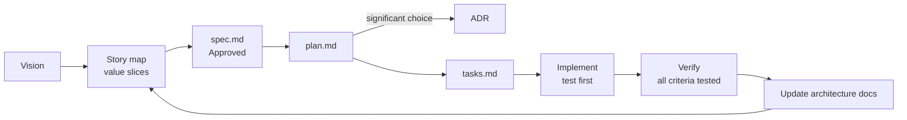

# Documentation

All project knowledge lives in git, next to the code, and changes through pull requests.

| Folder          | What                                                                  | Changes when                                  |
| --------------- | --------------------------------------------------------------------- | --------------------------------------------- |
| `product/`      | Vision and story map — _why_ and _in what order_                      | Priorities or goals change                    |
| `specs/`        | One folder per value slice — _what_ to build and how we know it works | Before each feature                           |
| `adr/`          | Architecture Decision Records — _why_ we chose something              | A significant technical choice is made        |
| `architecture/` | C4 diagrams and module map — _how_ it is built today                  | Module boundaries, interfaces or infra change |
| `testing/`      | Test strategy, coverage rules, regression suite                       | Test approach changes                         |
| `checklists/`   | Phase checklist for setup and launch                                  | As items are completed                        |

## Flow

## Value-based breakdown

1. **Vision** (`product/vision.md`) states who the users are and what outcome we want.
2. **Story map** (`product/story-map.md`) lays out the user journey as activities, with stories under each. Horizontal release lines cut it into slices.
3. **Walking skeleton first**: the thinnest end-to-end slice that touches every layer (sign up → see own profile → deployed with CI and security headers). It proves the architecture, not the features.
4. Each next slice is the one with the **highest value per effort, or the highest risk to retire**. Prefer slices that a real user could use and give feedback on.
5. A slice becomes a spec. A spec should fit in roughly 1–5 days of work; if larger, split it along user value (e.g. "send text message" before "send image in chat"), never by layer.

## Spec lifecycle

`Draft` → `Approved` → `In progress` → `Done` (or `Superseded by NNNN`).

Specs are numbered sequentially: `0001`, `0002`, … Numbers are never reused.

## ADR lifecycle

`Proposed` → `Accepted` → (`Deprecated` | `Superseded by ADR-NNNN`). Accepted ADRs are never edited except to change status; write a new ADR instead.
