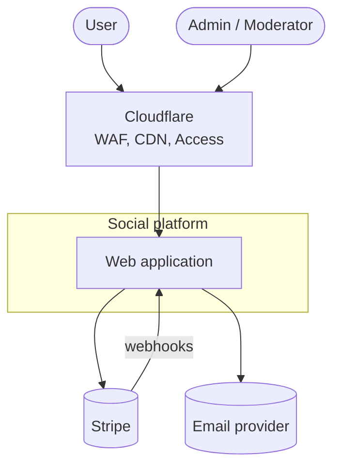
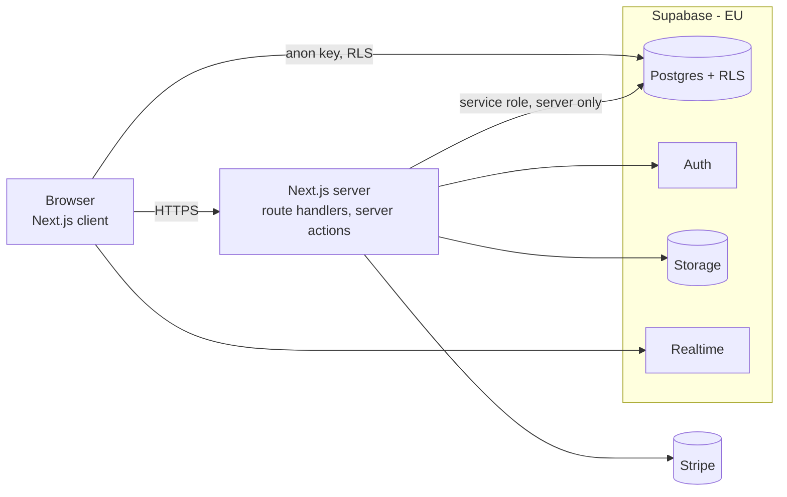
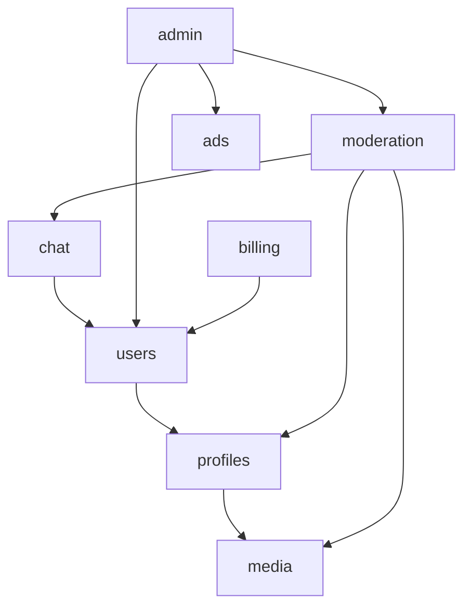

# Architecture overview

Lightweight arc42 + C4. Diagrams are Mermaid so they are versioned and diffable. **Keep this file in sync with the code** — update it in the same PR that changes boundaries, interfaces or infrastructure.

## 1. Goals and constraints

- Security first; EU data residency; GDPR and DSA compliance.
- Low running cost; managed services over self-hosting.
- Modular monolith (ADR-0002); stack per ADR-0003.

## 2. System context (C4 level 1)

## 3. Containers (C4 level 2)

## 4. Modules (C4 level 3)

| Module     | Responsibility                                | Owns tables (schema) | Public API (`contract.ts`) |
| ---------- | --------------------------------------------- | -------------------- | -------------------------- |
| users      | Accounts, roles, GDPR export/delete           | `users.*`            |                            |
| profiles   | Profile data, visibility                      | `profiles.*`         |                            |
| media      | Upload, validation, storage, signed URLs      | `media.*`            |                            |
| chat       | Conversations, messages, blocking             | `chat.*`             |                            |
| moderation | Reports, decisions, DSA log                   | `moderation.*`       |                            |
| billing    | Stripe customers, subscriptions, entitlements | `billing.*`          |                            |
| ads        | Ad slots and campaigns                        | `ads.*`              |                            |
| admin      | Admin UI, audit log                           | `admin.*`            |                            |

Arrows = allowed dependencies through public APIs. Cycles are not allowed.

## 5. Adapters

| Interface         | Real implementation                        | Fake (tests) |
| ----------------- | ------------------------------------------ | ------------ |
| `ObjectStorage`   | Supabase Storage (S3-compatible later: R2) | in-memory    |
| `PaymentProvider` | Stripe                                     | in-memory    |
| `RealtimeChannel` | Supabase Realtime                          | in-memory    |
| `Mailer`          | <provider>                                 | in-memory    |

## 6. Cross-cutting concepts

- **AuthN**: Supabase Auth; session from cookies, server-side verification.
- **AuthZ**: server-side role checks + RLS (defence in depth).
- **Validation**: Zod at every boundary.
- **Observability**: structured logs without personal data; error monitoring.
- **Audit**: all admin actions to `admin.audit_log`.

## 7. Deployment

<!-- Hosting, environments (local, preview, prod), secrets management, backups. -->

## 8. Risks and technical debt

| Item | Impact | Plan |
| ---- | ------ | ---- |
|      |        |      |
