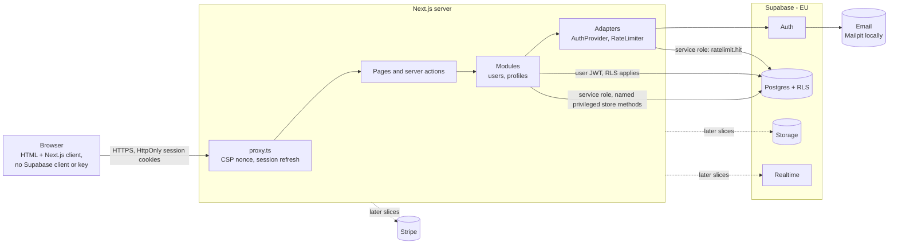
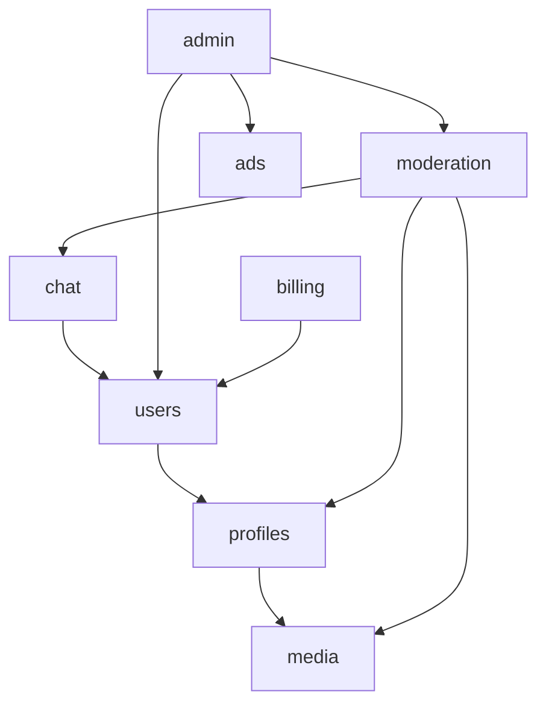

# Architecture overview

Lightweight arc42 + C4. Diagrams are Mermaid so they are versioned and diffable. **Keep this file in sync with the code** — update it in the same PR that changes boundaries, interfaces or infrastructure.

## 1. Goals and constraints

- Security first; EU data residency; GDPR and DSA compliance.
- Low running cost; managed services over self-hosting.
- Modular monolith (ADR-0002); stack per ADR-0003.

## 2. System context (C4 level 1)

## 3. Containers (C4 level 2)

All data access is server-side (ADR-0004): the browser never talks to Supabase. Each module reads its own tables through a store (`src/modules/<m>/store/`) with the user-scoped client by default, so RLS applies; the service-role client is used only in explicitly named privileged methods (e.g. `insertIfMissing`), after a server-side check. `src/server/container.ts` is the composition root that wires the real adapters and stores per request.

## 4. Modules (C4 level 3)

| Module     | Responsibility                                | Owns tables (schema)                                                                                                                                                     | Public API (`contract.ts`)                                                                                       |
| ---------- | --------------------------------------------- | ------------------------------------------------------------------------------------------------------------------------------------------------------------------------ | ---------------------------------------------------------------------------------------------------------------- |
| users      | Accounts, roles, GDPR export/delete           | schema `users`: no tables yet, only `erase_auth_leftovers` / `sweep_auth_leftovers` (service role; ADR-0006). Accounts live in Supabase `auth.users`, via `AuthProvider` | `UsersApi`: `signUp`, `resendVerification`, `confirmEmail`, `logIn`, `logOut`, `getCurrentUser`, `deleteAccount` |
| profiles   | Profile data, visibility                      | `profiles.profiles`                                                                                                                                                      | `ProfilesApi`: `ensureProfile` (privileged, called by users only), `getOwnProfile`                               |
| media      | Upload, validation, storage, signed URLs      | `media.*`                                                                                                                                                                |                                                                                                                  |
| chat       | Conversations, messages, blocking             | `chat.*`                                                                                                                                                                 |                                                                                                                  |
| moderation | Reports, decisions, DSA log                   | `moderation.*`                                                                                                                                                           |                                                                                                                  |
| billing    | Stripe customers, subscriptions, entitlements | `billing.*`                                                                                                                                                              |                                                                                                                  |
| ads        | Ad slots and campaigns                        | `ads.*`                                                                                                                                                                  |                                                                                                                  |
| admin      | Admin UI, audit log                           | `admin.*`                                                                                                                                                                |                                                                                                                  |

Arrows = allowed dependencies through public APIs. Cycles are not allowed. Empty cells are modules not built yet. No module ever takes a user ID from request input: identity comes from `users.getCurrentUser()` (server-verified session).

## 5. Adapters

| Interface         | Real implementation                                                                                                                                                                                                                        | Fake (tests)             | Status                                                          |
| ----------------- | ------------------------------------------------------------------------------------------------------------------------------------------------------------------------------------------------------------------------------------------ | ------------------------ | --------------------------------------------------------------- |
| `AuthProvider`    | Supabase Auth via `@supabase/ssr`, hardened cookies (`src/lib/adapters/auth/`). `verifyPassword` (re-authentication) and privileged `deleteUser` added in 0002; the service-role client is passed in explicitly and is `null` in the proxy | in-memory, issued tokens | Built (0001, 0002)                                              |
| `RateLimiter`     | Postgres fixed window, `ratelimit` schema, HMAC'd keys (ADR-0005, `src/lib/adapters/rate-limit/`)                                                                                                                                          | in-memory with a clock   | Built (0001)                                                    |
| `ObjectStorage`   | Supabase Storage (S3-compatible later: R2)                                                                                                                                                                                                 | in-memory                | Planned                                                         |
| `PaymentProvider` | Stripe                                                                                                                                                                                                                                     | in-memory                | Planned                                                         |
| `RealtimeChannel` | Supabase Realtime                                                                                                                                                                                                                          | in-memory                | Planned                                                         |
| `Mailer`          | <provider>                                                                                                                                                                                                                                 | in-memory                | Planned; in 0001 Supabase Auth sends verification emails itself |

The `ratelimit` schema belongs to the `RateLimiter` adapter, not to a module. Only `service_role` may call `ratelimit.hit()`; anon and authenticated have no access.

## 6. Cross-cutting concepts

- **Account deletion (ADR-0006)**: `users.deleteAccount` checks the session, our rate limit (per IP and per user) and the password, then deletes the auth user. That one transaction removes sessions and, through `ON DELETE CASCADE`, every module row. It then erases what Supabase Auth keeps outside `auth.users` (audit-log entries, PKCE flow states), with a daily `pg_cron` sweep as backstop. Data outside Postgres will go through an erasure queue (not built yet).
- **AuthN**: Supabase Auth behind `AuthProvider`; session in HttpOnly, SameSite=Lax, Secure cookies; every request verifies the user server-side (`auth.getUser`), never by decoding the JWT locally.
- **AuthZ**: server-side role checks + RLS (defence in depth).
- **Validation**: Zod at every boundary.
- **Rate limiting**: `RateLimiter` adapter, rules declared with `src/lib/rate-limit/` (per IP and per email; ADR-0005). The client IP comes only from the configured trusted header.
- **Security headers**: built in `src/lib/security/headers.ts`, set by `src/proxy.ts` with a per-request CSP nonce; every page renders dynamically so the nonce applies.
- **Observability**: structured JSON logs (`src/lib/log`) with allowlisted fields and email/JWT redaction; error monitoring later.
- **Audit**: all admin actions to `admin.audit_log`.

## 7. Deployment

<!-- Hosting, environments (local, preview, prod), secrets management, backups. -->

## 8. Risks and technical debt

| Item | Impact | Plan |
| ---- | ------ | ---- |
|      |        |      |
